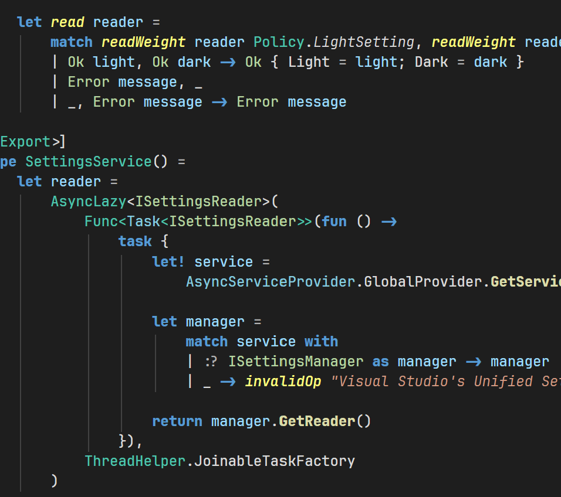
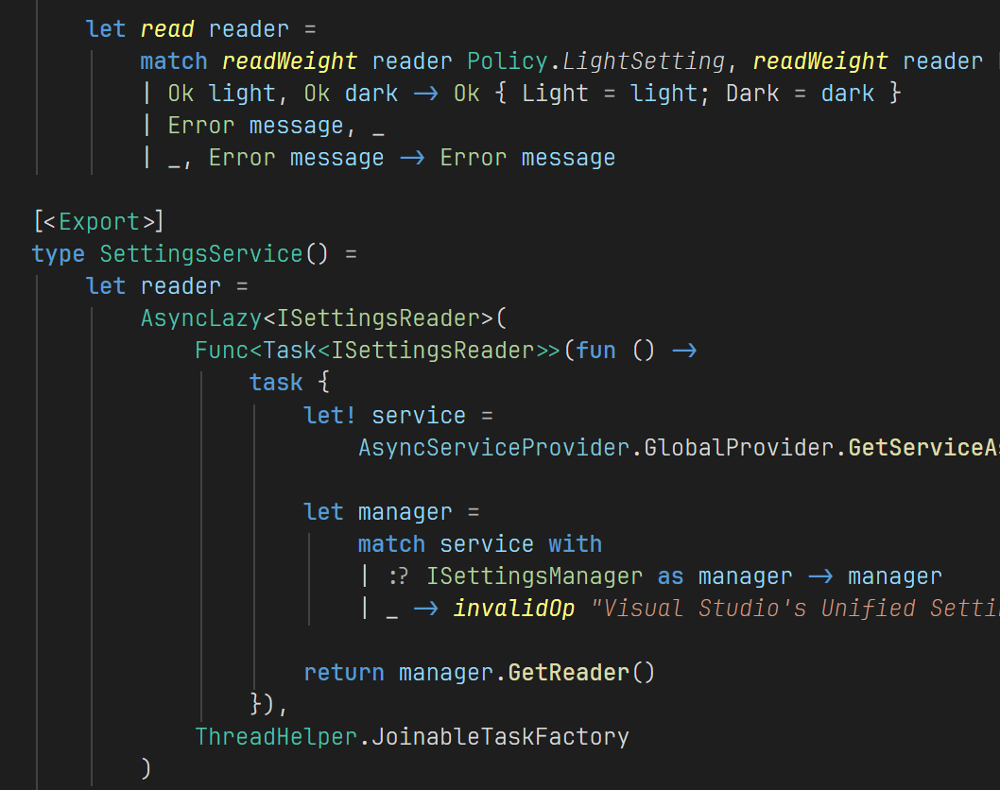

# Theme Font Weight

The default Visual Studio editor font is too heavy, especially in dark themes. This extension
makes the editor text lighter. You set one weight for light themes and one for dark themes.
Written entirely in F#.

| Before | After |
|---|---|
|  |  |

## Settings

1. Select **Tools > Options**.
2. Search for **Theme Font Weight**, or go to **Environment > Theme Font Weight**.
3. Select a weight for **Light theme font weight** and for **Dark theme font weight**.

The open editors change immediately. You do not have to restart Visual Studio.

The weights are Thin, Extra Light, Light, Normal, Medium, Semi Bold, Bold, Extra Bold and Black.
The default for the two settings is Normal.

## How the weight changes

The weight that you select moves all editor weights by the same quantity from Normal (400):

| Setting | Regular text | Bold text |
|---|---|---|
| Thin (100) | 100 | 400 |
| Light (300) | 300 | 600 |
| Normal (400) | 400 | 700 |
| Semi Bold (600) | 600 | 900 |

Thus bold text stays bolder than regular text. Classifications that have their own weight move by
the same quantity, in the range 100 to 900. Normal sets the original weights again.

The extension does not change the font family, the size, the colors, italic text or underlines.

The font must have the weight that you select. If it does not, WPF uses the nearest weight or
makes a synthetic weight.

## Light and dark themes

The extension uses the brightness of the tool window background to find if a theme is light or
dark. Thus it also operates with custom themes and high-contrast themes.

## Settings synchronization

The two settings synchronize with your other Visual Studio installations. To use this:

1. Install the extension on each computer.
2. Sign in with the same account.
3. Select **Tools > Options > Environment > Accounts** and turn on
   **Synchronize settings across devices and installs on this machine**.

## Requirements

- Visual Studio 2026 (18.x), x64. Insiders builds are supported.

## Remove the extension

Uninstall the extension in **Extensions > Manage Extensions**. Visual Studio then uses its usual
font weights.

## Feedback

Report problems and send ideas on
[GitHub](https://github.com/majocha/ThemeFontWeight/issues).

## License

The extension is open source under the
[MIT License](https://github.com/majocha/ThemeFontWeight/blob/main/LICENSE).
